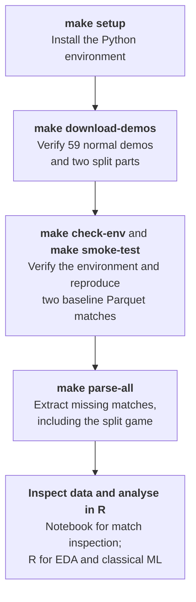

<!-- vim: set ft=markdown tw=88 nu ai et ts=2 sw=2: -->
<!-- markdownlint-disable-file MD041 -->

**Course:** Data Mining (5 ECTS), VU GMC and VU MIF, Autumn 2026

**Study programs:** MSc Bioinformatics, MSc Data Science

**Project:** Counter-Strike 2 round outcome prediction

**_cs2-rop_** is a four-person university Data Mining project predicting CS2 round
winners from professional match demos. Python and
[Awpy](https://github.com/pnxenopoulos/awpy) **3.1.1** extract the data into Parquet
tables. The team uses **R for downstream EDA, feature engineering, and classical
machine learning**. A Jupyter notebook provides a quick way to inspect a match.

**Current status:** The repository contains processed data for **60 games: 30 on
Dust2 and 30 on Mirage**, extracted from 61 recordings. One game was recorded in
two parts. Positions and health matched the earlier Go extraction exactly on
MOUZ vs. Spirit Dust2 and MOUZ vs. FURIA Mirage. All 60 games passed score consistency
checks (valid final scores and round totals). Three games were also compared with
official results: MOUZ vs. Spirit Dust2, MOUZ vs. FURIA Mirage, and Falcons vs. NAVI
Mirage. Feature engineering and modelling build on these extracted tables.

**Parameters and description:**

- Timeframe: 01.08.2026–11.10.2026.
- Teams and games: Top 10 teams playing each other in professional LAN matches.
- Maps: Dust2 and Mirage.
- Snapshots: All players every **1 second of live play**, from freeze end to round end.
- Extracted state: Position, side, health, armor, weapons, utilities, money, equipment
  value, and player status; event tables include kills, damage, bomb and round outcomes.
- External metadata such as historical player/team rankings is separate from extraction.
- Goal: Predict round winners from position and other in-game variables using
  classical ML in R.
- H0: Round outcomes are random and independent of position and other in-game variables.
- H1: Round outcomes are predictable from position and other in-game variables.

See [DESCRIPTION_PARAMETERS.md](./DESCRIPTION_PARAMETERS.md) for the research
background and literature review. The extraction details below describe the current
pipeline, including its one-second sampling interval.

## Table of contents

<!--toc:start-->
- [Table of contents](#table-of-contents)
- [Overview](#overview)
- [Workflow](#workflow)
- [Resources and literature](#resources-and-literature)
- [Quick start](#quick-start)
  - [Without GNU Make](#without-gnu-make)
  - [Windows](#windows)
- [Repository layout](#repository-layout)
- [Extract demos with Awpy](#extract-demos-with-awpy)
  - [Split recording](#split-recording)
- [Inspect a match](#inspect-a-match)
- [Data organization and Parquet tables](#data-organization-and-parquet-tables)
  - [Snapshots and identifiers](#snapshots-and-identifiers)
  - [Analysis tables](#analysis-tables)
  - [Analysis in R](#analysis-in-r)
- [Development commands](#development-commands)
  - [Build the report](#build-the-report)
  - [Environment and extraction verification](#environment-and-extraction-verification)
- [Troubleshooting](#troubleshooting)
  - [Regenerated Parquet files differ from Git references](#regenerated-parquet-files-differ-from-git-references)
<!--toc:end-->

## Overview

The current pipeline consists of:

- [`scripts/download_demos.py`](./scripts/download_demos.py): Downloads the recordings
  listed in the checksum manifest, routing split parts to `data/raw_split/`.
- [`scripts/extract_awpy.py`](./scripts/extract_awpy.py): Extracts normal recordings
  into 17 Parquet tables per match and updates a processing summary.
- [`scripts/recover_split_match.py`](./scripts/recover_split_match.py): Reconstructs
  the split Falcons vs. NAVI Mirage game as one match.
- [`scripts/build_analysis_tables.py`](./scripts/build_analysis_tables.py): Combines
  all processed matches into two team-level tables for R analysis.
- [`scripts/verify.py`](./scripts/verify.py): Checks the environment and reproduces
  the two baseline match folders without modifying committed data.
- [`notebooks/parser_check.ipynb`](./notebooks/parser_check.ipynb): Inspects an already
  processed match. It reads Parquet files only and needs no demos.

Earlier extraction used a Go parser based on demoinfocs before switching to Awpy.
That implementation and its five-second snapshot CSVs are available in Git history;
the current workflow does not require Go or an installable Python package.

## Workflow

The diagram shows the recommended sequence; commands do not automatically run the
next step. Processed data is committed, so extraction is optional for inspection
and R analysis. Verification uses two baseline demos. Extraction and split
recovery both skip existing match folders unless forced.



## Resources and literature

- [Project resources](./docs/resources.md): Taiga, HLTV statistics, demo-parsing
  libraries, and related CS2 research projects.
- [Research papers](./docs/papers/): Academic literature, references, and available PDFs.

## Quick start

You need Git and [uv](https://docs.astral.sh/uv/getting-started/installation/).
[`.python-version`](./.python-version) pins **Python 3.13.16**; uv downloads it if
needed. The primary workflow uses GNU Make with uv on `PATH`; on Windows, see
[Windows](#windows) for the recommended setup. Without GNU Make, use the
[direct workflow below](#without-gnu-make). Install R and its `arrow` package
separately for downstream analysis.

1. **Clone the repository.** Copy its HTTPS or SSH URL from GitHub, then run:

   ```text
   git clone <repository-url>
   cd cs2-rop
   ```

   Run subsequent commands from the repository root.

2. **Install Python dependencies:**

   ```text
   make setup
   ```

   uv creates `.venv/` with Awpy 3.1.1 and the development tools. This is a Python
   environment, not an installable project package; activation is not required.

3. **Download and verify the recordings** from the shared
   [Google Drive folder](https://drive.google.com/drive/folders/1UgOOA8CaxJsiOhflHg3al98Yb-lQi989):

   ```text
   make download-demos
   ```

   The **61 demos total approximately 21.4 GB**. The single manifest,
   [`data/raw_checksums.json`](./data/raw_checksums.json), records each filename,
   Drive ID, and SHA-256. Normal demos go to `data/raw/`; names ending in `-p1.dem`
   or `-p2.dem` go to `data/raw_split/`.

   Valid local files are stream-hashed and skipped without contacting Drive. Missing
   or invalid files are downloaded into temporary storage and verified before
   replacing the destination. Failed or interrupted downloads clean up temporary
   files and preserve any previous destination. Rerunning skips completed files,
   but still reads them to verify their hashes. Unlisted local files are untouched.

   Future Drive additions are not included automatically: add their records to the
   manifest. Manual downloads must use the same filenames and directory placement.
   Do not commit `.dem` files; `.gitignore` excludes them.

4. **Verify the environment and extraction:**

   ```text
   make check-env
   make smoke-test
   ```

   These commands require only the two MOUZ vs. Spirit baseline demos in `data/raw/`
   and their reference folders in `data/processed/`. The smoke test extracts into
   temporary storage and compares all 17 tables per match. It does not overwrite
   the committed matches. See [verification details](#environment-and-extraction-verification).

5. **Inspect the committed tables or start analysis in R.** Open
   [`notebooks/parser_check.ipynb`](./notebooks/parser_check.ipynb) to inspect a match,
   or start from the combined [analysis tables](#analysis-tables) in `data/analysis/`
   with R's `arrow` package. Neither needs the raw demos.

To regenerate data, follow [Extract demos with Awpy](#extract-demos-with-awpy).
Neither `setup` nor `check-env` downloads demos automatically, and initial inspection
does not require re-extracting the 60 committed games.

### Without GNU Make

Use these equivalent commands in native Windows PowerShell, Linux, or macOS:

```text
uv sync
uv run --no-sync python -B scripts/download_demos.py
uv run --no-sync python -B scripts/verify.py check-env
uv run --no-sync python -B scripts/verify.py smoke-test
```

To reproduce `make parse-all`, run normal extraction first, then split recovery only
after it succeeds:

```text
uv run --no-sync python -B scripts/extract_awpy.py --input data/raw --output data/processed
uv run --no-sync python -B scripts/recover_split_match.py --p1 data/raw_split/falcons-vs-natus-vincere-m3-mirage-p1.dem --p2 data/raw_split/falcons-vs-natus-vincere-m3-mirage-p2.dem --output data/processed
```

For the baseline matches, use these equivalents of `make parse-dust2` and
`make parse-mirage`; running both reproduces `make parse`:

```text
uv run --no-sync python -B scripts/extract_awpy.py --input data/raw/mouz-vs-spirit-m1-dust2.dem --output data/processed
uv run --no-sync python -B scripts/extract_awpy.py --input data/raw/mouz-vs-spirit-m2-mirage.dem --output data/processed
```

Add `--force` to either command to regenerate a match whose folder already exists.

### Windows

The Python scripts and the R analysis work on Windows as on Linux and macOS. For the
Make targets, the recommended setup is:

1. Install [Git for Windows](https://git-scm.com/downloads/win). It includes the
   **Git Bash** terminal with the Unix tools the Makefile uses (`find`, `rm`).
2. Install GNU Make, for example with [Scoop](https://scoop.sh/) (`scoop install make`)
   or [Chocolatey](https://chocolatey.org/) (`choco install make`).
3. Install [uv](https://docs.astral.sh/uv/getting-started/installation/), and R with
   the `arrow` package (`install.packages("arrow")` in R).
4. **Run all `make` commands from Git Bash**, not from PowerShell or `cmd`. Windows has
   its own unrelated `find.exe`, which `make clean` would pick up there, and the
   parsing recipes are split over several lines in a way `cmd` does not understand.

The direct commands under [Without GNU Make](#without-gnu-make) also work in
PowerShell, without Git Bash or Make.

To build the report, TeX Live for Windows already includes the Perl that latexmk
needs. With MiKTeX, also install Perl, for example
[Strawberry Perl](https://strawberryperl.com/).

[WSL](https://learn.microsoft.com/en-us/windows/wsl/install) also works, since it is
a full Linux environment, but it is not needed. If you use it, clone the repository
inside the Linux file system rather than on a Windows drive, which is much slower.

The Windows setup has not been tested end to end. Tell the team if something does
not work.

After extraction, rebuild the analysis tables:

```text
uv run --no-sync python -B scripts/build_analysis_tables.py
```

## Repository layout

```text
cs2-rop/
├── data/
│   ├── raw/                     # 59 normal demos, ignored by Git
│   ├── raw_split/               # Two split parts, ignored by Git
│   ├── raw_checksums.json       # Drive IDs and SHA-256 for all 61 recordings
│   ├── processed/               # 60 committed match folders and processing summary
│   ├── analysis/                # Committed round and per-second tables for R
│   ├── processed_csv_sample/    # Committed full CSV export of one baseline match
│   └── csv_export/              # Local CSV exports, ignored by Git
├── scripts/                     # Download, extract, recover, analysis tables,
│                                # verify, export
├── notebooks/                   # Match inspection notebook
├── reports/                     # LaTeX report, bibliography and style file
├── docs/                        # Resources and literature
├── DESCRIPTION_PARAMETERS.md    # Research background and parameters
├── Makefile                     # Setup, extraction, and development commands
├── .gitignore
├── pyproject.toml               # Python dependencies; uv package = false
├── uv.lock                      # Locked Python environment
└── .python-version              # Pinned interpreter
```

## Extract demos with Awpy

```text
make parse-all
```

This runs `extract_awpy.py` on `data/raw/`, then `recover_split_match.py` on the two
files in `data/raw_split/`. The normal extractor discovers `.dem` files in sorted
order, independently of the download manifest. Each match is written to
`data/processed/<match_id>/`, where `match_id` is the demo filename without `.dem`.
The split parts become one combined match folder.

Normal extraction skips any existing match folder unless forced. `make parse` selects
the two baseline matches; `make parse-dust2` and `make parse-mirage` select one each.
`make all` runs setup and baseline extraction. None of these targets downloads demos.

```text
make parse-dust2 FORCE=1
make parse-all FORCE=1
```

**`FORCE=1` maps to `--force` for both extraction and split recovery, and replaces
the selected match folders, including committed references.** Review regenerated
data before committing it. Both scripts write their tables through a temporary match
directory before replacing the final folder, and sort each table's rows before
writing, so rerunning on the same demo produces identical files.

`data/processed/processed_summary.csv` has one row per processed match, including
map, score, rounds, snapshot rows, status, warnings, and elapsed extraction time in
`seconds`. Processing a match replaces its previous summary row; skipped folders
are not re-summarized. Failed normal extractions are reported in the summary and
cause a nonzero exit. The Makefile does not start split recovery after a failed
normal extraction command.

### Split recording

`falcons-vs-natus-vincere-m3-mirage` has two recordings. Keep them in `data/raw_split/`:

```text
falcons-vs-natus-vincere-m3-mirage-p1.dem
falcons-vs-natus-vincere-m3-mirage-p2.dem
```

The normal extractor stops before extracting anything if its input contains a name
ending in `-p1`, `-p2`, or another numbered part. The downloader's directory rule
keeps the two known parts out of that input on a fresh clone.

Part 1 has no usable round events. Recovery reconstructs round ends and winners
from team score changes, using freeze-end events to separate played rounds from
warmup. Recovered reason fields and unavailable boundary ticks remain null;
part-1 economy is rebuilt from freeze-end snapshots, with unknown buy types left
null except the opening pistol round. Part 2 is extracted normally.

The combined tables have `part` **0 or 1**. Ticks remain local to each part, so
include `part` when joining tick-indexed tables: `(match_id, part, tick)`. Round
numbers continue across parts. For a read-only diagnosis of part 1, run:

```text
uv run --no-sync python -B scripts/recover_split_match.py --check --p1 data/raw_split/falcons-vs-natus-vincere-m3-mirage-p1.dem --p2 data/raw_split/falcons-vs-natus-vincere-m3-mirage-p2.dem
```

## Inspect a match

Open [`notebooks/parser_check.ipynb`](./notebooks/parser_check.ipynb) in a
Jupyter-capable editor, select the project's `.venv` kernel, and run cells in order.
Set `match_name` to any folder in `data/processed/`, for example:

```python
match_name = "mouz-vs-spirit-m1-dust2"
```

The notebook reads committed Parquet tables only. It needs no demos, performs no
extraction, and can start from the repository root or `notebooks/`. It shows table
sizes, rounds, snapshots, living-player team state, and kills. Python supports
extraction and this inspection tool; downstream EDA and modelling take place in R.

For a CSV view, run:

```text
uv run --no-sync python -B scripts/export_csv_sample.py --match mouz-vs-spirit-m1-dust2
```

The default destination is `data/csv_export/<match_id>/`, with up to 5,000 rows per
table and an `overview.csv` containing full row counts and column names. Add
`--max-rows 0` for a full export. `data/processed_csv_sample/mouz-vs-spirit-m1-dust2/`
already contains a committed full export of all 17 tables plus the overview.

The development environment includes nbconvert and Jupytext for notebook conversion:

```text
uv run jupyter nbconvert --to markdown notebooks/parser_check.ipynb
uv run jupytext --to py:percent notebooks/parser_check.ipynb
```

These commands convert without executing the notebook. Review exported files and
notebook outputs before adding them to Git.

## Data organization and Parquet tables

| Directory                    | Contents                                              | Tracked by Git?       |
| ---------------------------- | ----------------------------------------------------- | --------------------- |
| `data/raw/`                  | Normal `.dem` recordings                              | No, except `.gitkeep` |
| `data/raw_split/`            | The two split recordings                              | No, except `.gitkeep` |
| `data/processed/`            | 60 match folders and `processed_summary.csv`          | Yes                   |
| `data/analysis/`             | Round and per-second analysis tables, Parquet and CSV | Yes                   |
| `data/processed_csv_sample/` | Full CSV export of one baseline match                 | Yes                   |
| `data/csv_export/`           | Local CSV inspection exports                          | No                    |

Each processed match has these **17 Parquet tables**:

| Table           | Contents                                                 |
| --------------- | -------------------------------------------------------- |
| `rounds`        | Round boundaries, winner, reason, and overtime flag      |
| `kills`         | Kill events and attacker/victim details                  |
| `damages`       | Damage events                                            |
| `bomb`          | Bomb events                                              |
| `grenades`      | Grenade trajectories                                     |
| `fires`         | Fire areas and timing                                    |
| `smokes`        | Smoke areas and timing                                   |
| `shots`         | Weapon-fire events                                       |
| `stats`         | Whole-match player totals; not round-prediction features |
| `players`       | Player identifiers and team information                  |
| `round_economy` | Round/side economy and buy information                   |
| `chat`          | Chat messages                                            |
| `blinds`        | Flash-blind events                                       |
| `item_events`   | Item-related events                                      |
| `header`        | Demo header as key/value rows                            |
| `convars`       | Server configuration as key/value rows                   |
| `snapshots`     | Player state sampled every second during live play       |

Every table carries `match_id`. Tick-indexed event tables carry `round_num` and
`in_play` to distinguish live play from freeze time, warmup, and post-round events.
The `rounds` table has `is_overtime`. The combined split match additionally carries
`part` on every table. Empty event tables are valid when that event did not occur.

### Snapshots and identifiers

The default interval is **1 second**, starting at each round's `freeze_end_tick`
and stopping before `end_tick`. The extractor calculates the tick stride from the
demo's tick rate; `--seconds` can select another interval for exploratory extraction.
The committed tables and smoke test use one second.

Snapshots contain **all players, including dead players**. Use **`health > 0`** to
select alive players. Dead players have health 0, and most of their rows have no
`steamid`, `name`, or `team_clan_name`; only `side` is reliable for attributing those
rows to a side. Do not count non-null identifiers as a proxy for all snapshot rows.

Snapshots have **no `in_play` column** because every row is already from live play.
Their fields cover position and velocity, view angles, health and armor, weapons
and utilities, equipment and money, and status flags. They are sampled states, not
full per-tick trajectories. Row order is not a reliable key for comparing tables.

### Analysis tables

[`scripts/build_analysis_tables.py`](./scripts/build_analysis_tables.py) combines all
match folders in `data/processed/` into two team-level tables for EDA and modelling in
R. Both are written to `data/analysis/` as Parquet and CSV:

| Table          | Rows    | One row per          |
| -------------- | ------- | -------------------- |
| `rounds`       | 1,257   | Round of every match |
| `round_states` | 116,201 | Second of live play  |

`rounds` holds, per round: the team on each side, the score before the round, whether
the CT team won the previous round, buy type and equipment value per side at freeze
end, pistol-round and overtime flags, whether and where the bomb was planted, the side
that lost the first player, the round duration, and the outcome.

`round_states` holds, per second of live play: time since freeze end, time remaining
(the round timer, or the bomb timer after a plant), bomb state (planted, seconds since
plant, site, carried), and for each side's **living players only**: alive count, HP,
armor, helmets, defusers, equipment value, money, rifles, AWPs, SMGs and grenades by
type. Each row also carries the teams, the score before the round and the outcome.

Notes:

- **Labels:** `winner_side`, `winner_team`, `ct_win` and `reason_name` describe how the
  round ended. They are prediction targets, not features.
- **Round-level columns from later in the round:** in `rounds`, `bomb_planted`,
  `plant_site`, `plant_tick`, `first_death_side`, `end_tick` and `round_duration_s`
  are only known during or after the round. Do not use them as features for a
  prediction made earlier in the round. `round_states` gives the bomb state as known at
  each second.
- **Teams and identifiers:** team names are normalised to one name per team (for
  example "Team Vitality" and "Vitality" both become `Vitality`). The tables contain no
  Steam IDs.
- **Split game:** `part` is 0 for every match except
  `falcons-vs-natus-vincere-m3-mirage` (0 = first half, 1 = second half). Ticks are
  unique only within `(match_id, part)`. `reason_name` is empty for that match's
  rounds 1-12.

To regenerate both tables after changing `data/processed/`:

```text
uv run --no-sync python -B scripts/build_analysis_tables.py
```

Add `--no-csv` to write Parquet only.

### Analysis in R

Read the Parquet tables directly with the R
[`arrow` package](https://arrow.apache.org/docs/r/reference/read_parquet.html):

```r
snapshots <- arrow::read_parquet("data/processed/mouz-vs-spirit-m1-dust2/snapshots.parquet")
```

For most analysis, start from the combined tables in `data/analysis/`:

```r
rounds <- arrow::read_parquet("data/analysis/rounds.parquet")
states <- arrow::read_parquet("data/analysis/round_states.parquet")
```

Without `arrow`, read the CSV copies with `readr::read_csv()`.

**Preserve identifier precision:** `steamid` is a `uint64` identifier, not a numeric
measurement. Converting it to an R double loses precision for these large IDs.
Use `name` for player labels, or convert `steamid` to text while it is still an
exact integer in Arrow. Converting an already rounded double to text cannot recover
the original ID. Account for the missing identities of dead players described above.

**Avoid target leakage:** `stats` contains whole-match player totals, including
information from rounds that have not happened at the prediction time. Do not use
that table as features for predicting a round. Build features from information
available at the chosen prediction time instead.

The team develops EDA, features, and classical ML models in R. The extraction tools
do not train models or automatically enrich the data with historical rankings.

## Development commands

Use `make help` for the full target list:

- `make setup`: Install the Python environment with `uv sync`.
- `make download-demos`: Verify and download all manifest recordings into the two
  raw directories.
- `make check-env`: Verify Python, imports, demo headers, and baseline tables.
- `make smoke-test`: Reproduce all tables for the two baseline matches in temporary
  storage and compare them with the committed references.
- `make parse`: Extract the two baseline demos, skipping existing match folders.
- `make parse-all`: Extract missing normal matches, then the split match if missing.
- `make parse-dust2` / `make parse-mirage`: Extract one baseline match.
- `make pylint`: Run Ruff and Black, including automatic fixes and formatting.
- `make shlint`: Run ShellCheck and shfmt; these tools are installed separately.
- `make lint`: Run Python and shell linting/formatting.
- `make report`: Compile the LaTeX report; see [Build the report](#build-the-report).
- `make clean-report-aux`: Remove LaTeX temporary files, keeping the report PDF.
- `make clean-report`: Remove all generated LaTeX files, including the report PDF.
- `make clean`: Remove disposable caches and LaTeX temporary files, preserving
  environments, datasets, and the report PDF.

`FORCE=1` regenerates existing matches on parsing targets. Linting targets also
modify files; review `git diff` afterward. Without Make, Python formatting can use
`uv run ruff check . --fix` and `uv run black .`.

### Build the report

The paper lives in [`reports/`](./reports/), with
[`data_mining_report.tex`](./reports/data_mining_report.tex), its bibliography
`bibliography.bib`, and the `jmlr2e.sty` style file. Building it requires
[latexmk](https://ctan.org/pkg/latexmk) and a LaTeX distribution with pdflatex and
BibTeX, for example TeX Live or MiKTeX. On Windows, see [Windows](#windows) for the
Perl that latexmk needs:

```text
make report
```

`make report` always runs latexmk, which tracks the report's sources and recompiles
only when something changed. It stops on the first LaTeX error. The PDF is written
to `reports/data_mining_report.pdf`.

`make clean` removes LaTeX temporary files but keeps the PDF. `make clean-report`
also removes the PDF. Without Make, run latexmk directly:

```text
latexmk -pdf -cd -interaction=nonstopmode -halt-on-error reports/data_mining_report.tex
```

### Environment and extraction verification

Follow [Quick start](#quick-start) for setup and the
[direct alternative](#without-gnu-make) for native Windows without GNU Make.

`check-env` requires the project `.venv`, the pinned interpreter, and Awpy matching
the version in `pyproject.toml`. It runs `uv pip check`, imports Awpy, Polars, pandas,
and PyArrow, checks the two baseline CS2 demo headers, and reads all 17 tables in
each reference folder. It accepts empty event tables but requires nonempty rounds,
snapshots, and header tables. Every table must carry the expected `match_id`.

`smoke-test` then requires those two reference folders to match Git `HEAD`, verifies
both demo SHA-256 values against the manifest, and runs the extractor at one-second
sampling into temporary storage. It compares all **34 tables**, requiring identical
schemas, values, nulls, and duplicate-record counts while ignoring row order and
Parquet encoding. `processed_summary.csv` is not compared because it includes elapsed
runtime. Temporary output is removed after success or failure, and failures return
a nonzero exit code. Neither command modifies committed datasets or the notebook.

When changing Python dependencies, commit `uv.lock` with `pyproject.toml`. Re-run
`make setup` to synchronize the environment; verification does not install packages.
The two baseline matches have 20 Dust2 rounds and 18 Mirage rounds. The smoke test
checks reproducibility of these baselines, not the scientific correctness of a model.

On Windows, run the Make targets from Git Bash, as described under
[Windows](#windows). The direct commands under [Without GNU Make](#without-gnu-make)
also work in PowerShell.

## Troubleshooting

- **Demo download fails:** Check your connection and the shared Drive folder. All 61
  manifest files must permit public downloads. Drive quotas may require retrying
  later. A checksum mismatch discards the download and preserves any previous file;
  persistent mismatches should be checked with the team.
- **Split recordings stop normal extraction:** Put `-p1` and `-p2` files in
  `data/raw_split/`, not `data/raw/`. The downloader now routes them correctly.
  `make parse-all` runs the dedicated recovery after normal extraction succeeds.
- **`uv` is not recognized or imports fail:** Ensure uv is on `PATH`, run `make setup`,
  and select `.venv` as the notebook kernel. Its interpreter is normally
  `.venv/Scripts/python.exe` on Windows or `.venv/bin/python` on Linux/macOS.
- **An existing match is incomplete or stale:** Extraction and split recovery check
  whether the folder exists and skip it. Review the folder, then use the appropriate
  parsing target with `FORCE=1` to regenerate it.
- **Dead-player identities are missing:** This is present in the snapshot output.
  Filter `health > 0` for living-player features and use `side` for dead-player side
  attribution; do not assume every row has a player name or Steam ID.

### Regenerated Parquet files differ from Git references

Regenerated tables may differ in file encoding or row order from the committed
references. That alone does not establish different records. The smoke test compares
tables independently of row order, but its Git guard first requires the two reference
folders to be unchanged, including staged and unstaged edits.

For unintentional regeneration, restore those folders from `HEAD`. **These commands
discard staged and unstaged changes to the two baseline folders. Review intentional
changes before restoring them.**

```text
git restore --source=HEAD --staged --worktree -- data/processed/mouz-vs-spirit-m1-dust2
git restore --source=HEAD --staged --worktree -- data/processed/mouz-vs-spirit-m2-mirage
make smoke-test
```

Real value, schema, or record-count differences must be investigated before changing
the committed baselines. Other matches are outside this two-match regression check.
